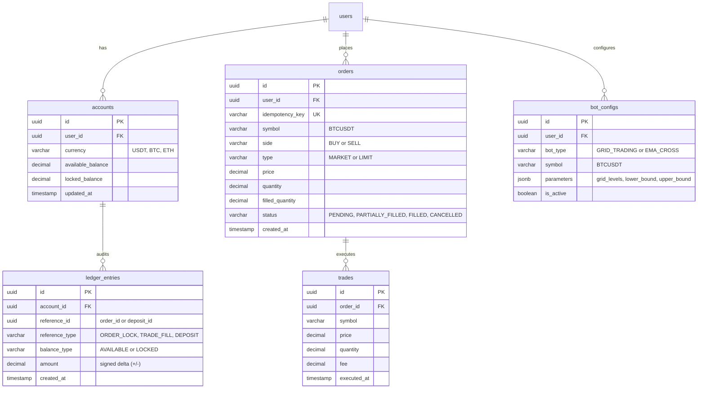

# Kế hoạch Triển khai FinTrade Backend

## High-Throughput Algorithmic Trading & Paper-Trading Engine

---

## 1. Bối cảnh & Tầm nhìn Dự án

### 1.1. Bối cảnh & Mục tiêu

- **Định vị dự án**: Sàn giao dịch mô phỏng (Paper-Trading) và chạy bot giao dịch thuật toán (Algorithmic Trading) thời gian thực trên dữ liệu thị trường trực tiếp từ Binance (BTC/USDT, ETH/USDT, SOL/USDT).
- **Mục tiêu kỹ thuật**: Chuyển dịch và nâng tầm từ **Frontend Engineer** sang **Fullstack / Backend & System Design**. Dự án được thiết kế để giải quyết các bài toán hóc búa nhất trong ngành Fintech/Chứng khoán mà nhà tuyển dụng cao cấp tìm kiếm:
  1. **Tính toàn vẹn dữ liệu tài chính (Financial Ledger Integrity)**: Tuyệt đối không update đè số dư, áp dụng sổ cái kép (Double-Entry Bookkeeping), đảm bảo chuẩn ACID và xử lý triệt để Race Condition / Concurrency bằng Row-Level Locking (`SELECT FOR UPDATE`).
  2. **Tách biệt Data Plane & Transaction Plane**: Tách bạch luồng dữ liệu thị trường thông lượng cao (High-Throughput Streaming via **Kafka**) khỏi luồng giao dịch có tính tin cậy tuyệt đối (Transactional Execution via **RabbitMQ**).
  3. **High-Throughput Streaming & Backpressure**: Tiếp nhận và phân phối hàng chục nghìn tick/giây từ Binance mà không gây nghẽn memory hay crash server.
  4. **Idempotency & Khớp lệnh**: Chống click đúp lệnh bằng Idempotency Key (Redis) và mô phỏng khớp lệnh thời gian thực theo cơ chế Price-Time Priority.
  5. **Tối ưu tài nguyên trên 1 host cá nhân**: Tối ưu toàn bộ hệ thống (K3s, Kafka KRaft, RabbitMQ, Redis, Postgres, NestJS services) chạy mượt mà trong giới hạn **6GB - 8GB RAM**.

---

## 2. Kiến trúc Hệ thống Tổng thể

```mermaid
flowchart TD
    subgraph MarketDataLayer ["1. Market Data Pipeline (High-Throughput)"]
        BW[Binance Public WebSocket] -->|Ticks BTC, ETH, SOL| IS[Ingestion Worker]
        IS -->|Producer: market.ticks| KF[(Kafka Broker - KRaft)]
        KF -->|Consumer Group: MarketBoard| AGG[OHLCV Aggregator]
        KF -->|Consumer Group: SignalEngine| SIG[Alpha Signal & Bot Engine]
        KF -->|Consumer Group: Matcher| ME[Order Matching Engine]
    end

    subgraph TransactionLayer ["2. Transaction & Execution Plane (Reliability)"]
        CL[Next.js Client / Bot] -->|POST /orders + Idempotency-Key| API[Order API Gateway]
        API -->|Check & Set Key| RD[(Redis Cache)]
        API -->|Publish OrderIntent| RMQ[(RabbitMQ orders.queue)]
        RMQ -->|Manual Ack & DLX| ME
        ME -->|Acquire Lock & Match| DB[(PostgreSQL Ledger)]
        ME -->|Order Filled / Rejected| RMQ_EV[RabbitMQ events.exchange]
    end

    subgraph RealtimeBroadcast ["3. Realtime Gateway (Centrifugo Go Engine) & UI Terminal"]
        AGG -->|Aggregated Candles & Ticks (HTTP Publish)| CF[(Centrifugo Engine - Go)]
        RMQ_EV -->|Account & Order Filled Events| CF
        CF -->|WebSocket multiplexed channels: public & personal| FE[Next.js Trading Terminal]
    end
```

---

## 3. Thiết kế Cấu trúc Dữ liệu & Database Sổ Cái Kép

### 3.1. Phân hệ Tài khoản & Sổ cái (Ledger Engine)

Hệ thống sử dụng nguyên tắc **Double-Entry Bookkeeping**:

- `accounts`: Đại diện cho tài khoản tài sản của user (ví dụ USDT, BTC, ETH). Mỗi account quản lý 2 trường: `available_balance` và `locked_balance`.
- `ledger_entries`: Mọi biến động tiền đều sinh ra 1 bản ghi sổ cái. Số dư `available` và `locked` của account phải luôn bằng tổng delta các bản ghi ledger tương ứng.
- Tuyệt đối không trừ trực tiếp số dư mà không có `transaction_id` và `ledger_entry`.



---

## 4. Kế hoạch Triển khai Từng Bước (Implementation Roadmap)

| Giai đoạn                                               | Nội dung công việc chính                                                                                                                                                                               | Deliverables / Artifacts                                                                     |
| :------------------------------------------------------ | :----------------------------------------------------------------------------------------------------------------------------------------------------------------------------------------------------- | :------------------------------------------------------------------------------------------- |
| **Pha 1: Hạ tầng & Cấu hình Core**                      | Bổ sung Kafka (KRaft mode), RabbitMQ & Centrifugo vào `docker-compose-dev.yml`. Cài đặt các thư viện `amqplib`, `kafkajs`, `bignumber.js`, `ws`. Chuẩn hóa Config module.                              | Cụm Docker Compose (Postgres + Redis + Kafka + RabbitMQ + Centrifugo) hoạt động ổn định.     |
| **Pha 2: Financial Ledger & Balance Engine**            | Thiết kế Entity `Account`, `LedgerEntry`. Viết Service xử lý nạp tiền sandbox, khóa tiền đặt lệnh (lock), mở khóa (unlock), cấn trừ khi khớp (settle) bằng `SELECT ... FOR UPDATE` (Pessimistic Lock). | Bộ API quản lý tài khoản & Unit/E2E test chứng minh chống Race Condition thành công.         |
| **Pha 3: Binance Ingestion & Kafka Pipeline**           | Xây dựng Worker kết nối WebSocket Binance (`wss://stream.binance.com:9443`), tiếp nhận ticker và depth. Producer bắn vào topic `market.ticks`. Aggregator tính nến 1s/1m/15m.                          | Stream dữ liệu thị trường trực tiếp chạy ngầm liên tục, có đo lường lag và throughput.       |
| **Pha 4: Order Submission & RabbitMQ Processing**       | Xây dựng API đặt lệnh `/api/orders` với Header `Idempotency-Key` (lưu TTL trong Redis). Đẩy lệnh vào RabbitMQ `orders.queue`. Worker tiêu thụ lệnh, kiểm tra số dư và chuyển vào Orderbook.            | Hệ thống tiếp nhận lệnh bất đồng bộ an toàn, không rớt lệnh, chống submit trùng lặp.         |
| **Pha 5: In-Memory Orderbook & Matching Engine**        | Triển khai sổ lệnh trong bộ nhớ bằng cấu trúc Redis Sorted Sets hoặc Heap trong RAM. Mô phỏng khớp lệnh Limit/Market theo giá thực Binance. Cập nhật trạng thái lệnh & ghi sổ cái.                     | Engine khớp lệnh mô phỏng Paper-Trading hoàn chỉnh, tính toán Realized & Unrealized PnL.     |
| **Pha 6: Realtime Gateway với Centrifugo & Throttling** | Tích hợp Centrifugo HTTP Publisher & JWT Subscription Token. Client Next.js subscribe channel `public:ticks:*` và `personal:user_id`. Throttling 50-100ms bảo vệ DOM UI.                               | Realtime Gateway hiệu năng cao, zero-lag trên Node.js event loop, Next.js render mượt 60fps. |
| **Pha 7: Automated Trading Bot (Grid & Alpha Signal)**  | Viết Worker chạy chiến lược Grid Trading và chiến lược EMA Cross (9/21). Bot tự động sinh lệnh gửi vào RabbitMQ khi điều kiện thị trường thỏa mãn.                                                     | Module bot tự động giao dịch mô phỏng, có dashboard cấu hình thông số và theo dõi PnL.       |
| **Pha 8: Containerize, Kubernetes (K3s) & Metrics**     | Viết Dockerfile multi-stage cho từng service. Tạo K8s manifests (Deployments, Services, Ingress, Secrets). Cấu hình Prometheus + Grafana giám sát Latency P99.                                         | Toàn bộ hệ thống chạy trên cụm K3s máy chủ cá nhân với mức RAM tối ưu dưới 8GB.              |

---

## 5. Những "Điểm Ăn Điểm" Khi Phỏng Vấn (Resume Highlights)

1. **Event-Driven Architecture**:
   - Giải thích rõ ràng tại sao dùng **Kafka** cho Market Data (Pub/Sub high-throughput, replayable event log) và dùng **RabbitMQ** cho Order Execution (Transactional queue, AMQP ack, Dead Letter Queue).
2. **Financial Integrity**:
   - Thao diễn mô hình Double-Entry Bookkeeping và giải pháp triệt tiêu Race Condition bằng Row-Level Locking (`SELECT FOR UPDATE`).
3. **High Concurrency & Idempotency**:
   - Cơ chế bảo vệ Idempotent REST API sử dụng Redis distributed locking / TTL keys để chặn duplicate submit từ user hoặc network retry.
4. **Senior Frontend Insight (Fullstack Bridge)**:
   - Thấu hiểu bài toán Client-side Backpressure: Cơ chế throttling / buffer ở backend kết hợp Web Workers ở frontend Next.js để render bảng giá và TradingView Lightweight Charts ở tốc độ 60fps mượt mà.
